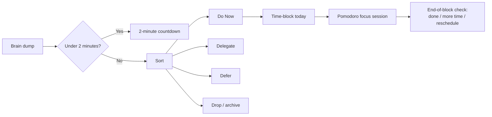

# Timely

**A personal planning app that takes you from an overwhelming to-do list to focused, time-blocked work.**

Timely runs one daily loop: get everything out of your head, sort it, give the chosen work a time slot today, then do that slot in Pomodoro intervals. It is built for one person working across a Mac and an iPhone, and it is deliberately small. The guiding rule is *no productivity theater*: no feature ships before the core loop works and gets used.

> **Status: design complete, implementation starting.**
> Requirements, user stories, UX, architecture, API contracts and the delivery plan are written and reviewed. Construction of the first slice (the walking skeleton) is under way. There is no runnable application code in this repository yet. See [Project status](#project-status).

---

## Why this project

Most to-do apps capture tasks well but don't help you *execute* them. Timely is built on a few well-known behavioral techniques and combines them into one flow:

| Problem | Technique Timely builds in |
|---|---|
| A huge list causes background anxiety | **Brain dump**: capture everything quickly, one item per line, no categorizing yet |
| Small tasks clutter the list | **2-minute rule**: if it takes under two minutes, do it now with a built-in countdown |
| Everything feels urgent | **Do Now / Delegate / Defer / Drop** sorting, with follow-up dates and an archive you can restore from |
| Tasks too vague to start | **Micro-steps** ("smallest physical next step") and a **5-minute "just start"** timer |
| Drifting between shallow tasks | **Time-blocking** today's work on a timeline beside your Google Calendar events |
| Focus breaks down | **Pomodoro** sessions (25/5, with a 15-minute break after every 4) and background notifications |
| Chat and email all day | **Communication batching** reminders at set windows (default 10:00, 13:00, 16:00) |

## The core loop

*Text version:* Brain dump → 2-minute rule → sort into Do Now / Delegate / Defer / Drop → time-block Do Now items today → Pomodoro session → at the end of the block, mark it done, extend it, or reschedule.

## Architecture (as designed)

Timely is a **modular monolith**: one deployable server process that serves both the web app and a JSON API, running on a single self-hosted server over HTTPS. The web app is installable on the iPhone home screen and works in a two-panel layout on the Mac.

Inside the app there are nine modules with clear ownership. They talk only through defined interfaces and in-process events, never through each other's data:

| Module | Owns |
|---|---|
| **Account** | The owner, sign-in, sessions, preferences, time zone |
| **Tasks** | The whole task lifecycle: capture, 2-minute rule, sort categories, archive |
| **Planning** | Time blocks on today's timeline |
| **Focus** | Every countdown (2-minute, 5-minute start, Pomodoro), derived from recorded start times so timers survive sleep and reload |
| **Notifications** | Web Push subscriptions and scheduled alerts |
| **CalendarSync** | Two-way Google Calendar sync behind an anti-corruption layer |
| **Insights** | The weekly summary, computed on request |
| **Verses** | A short daily reflection shown at planning time |
| **WebApp** | The screens |

Key design decisions are written up as ten ADRs, each with the alternatives considered. Some highlights:

- **The server decides every rule** (ADR-009). The client never enforces business logic on its own, and entity versions catch conflicting edits made on the Mac and the iPhone at the same time.
- **Transactional outbox for internal events** (ADR-010, contract C2). State changes and the events they trigger are committed together, which breaks dependency cycles between modules without losing events.
- **Calendar sync is isolated** (ADR-004). Google's data model never leaks into Timely's. If Google is unreachable, the app keeps working, shows when the calendar last synced, and retries without creating duplicate events.
- **Timers are computed, not ticked** (ADR-002). Remaining time comes from recorded timestamps, so a locked phone or a background tab never drifts.

Security basics are part of the contract, not added later: `Secure`/`HttpOnly`/`SameSite` session cookies, CSRF tokens on every state-changing request, sign-in rate limiting, password hashes only, input validated at every boundary, and secrets only in environment variables.

## How it's being built

The project uses a structured, AI-assisted development lifecycle (AI-DLC, the AI-Driven Development Life Cycle). Each stage produces a written artifact, gets an independent review, and waits for explicit approval before the next stage starts. The result is a full paper trail from idea to code. Every requirement traces back to the original problem statement, and every story traces to a requirement.

Engineering practices that were agreed before any code is written:

- **Walking skeleton first.** The first build is the thinnest end-to-end slice of the whole loop, verified on a real iPhone, before any other feature.
- **Test-after with a hard floor.** Every Bolt (build increment) ships with its tests, at least 80% line coverage, and CI that blocks the merge on failing tests, low coverage or lint errors.
- **Trunk-based development.** Short-lived branches, each squash-merged into `main` as one commit.
- **A "use-it" gate between increments.** Before the next increment starts, the owner must plan at least one real day with the app as it stands. If the core loop turns out to be enough, later increments get dropped.

## Project status

| Phase | Stage | Status |
|---|---|---|
| Inception | Practices discovery | ✅ Done |
| | Requirements analysis (12 functional requirement groups, with Given/When/Then acceptance criteria) | ✅ Done |
| | User stories (32 stories, personas) | ✅ Done |
| | Refined mockups, interaction spec, accessibility checklist | ✅ Done |
| | Domain design (9 modules, 10 ADRs) | ✅ Done |
| | Units of work (5 feature slices) | ✅ Done |
| | Contract design (HTTP API, internal events, module interfaces, Google Calendar, Web Push) | ✅ Done |
| | Delivery plan (5 Bolts, risks and sequencing) | ✅ Done |
| Construction | **Bolt 1: Core loop (walking skeleton)**: functional design | 🔄 In progress |
| | Bolt 1: NFRs and tech stack, NFR design, infrastructure, code, build and test | ⏳ Next |
| | Bolts 2–5 | ⏳ Planned |

### Delivery plan

| # | Bolt | What it adds |
|---|---|---|
| 1 | **Core loop** (walking skeleton) | Sign in → brain dump → 2-minute rule → Do Now → time-block today → Pomodoro → notification |
| 2 | Sort and lists | Delegate, Defer, Drop with undo and restore, follow-up reminders, drafts kept through session expiry |
| 3 | Day and focus | Overlap flags, carry-over, pause and resume, 5-minute start, end-of-block decisions, Mac/iPhone edit conflicts |
| 4 | Calendar sync | Two-way Google Calendar sync, offline resilience, reconnect flow |
| 5 | Reminders and insights | Communication batching reminders, daily verse, weekly summary |

### Tech stack

Not chosen yet. It is the next decision, made in Bolt 1's NFR stage. The leading option is **TypeScript end to end** (a Node.js server and a React installable web app with shared API types) on **SQLite** in write-ahead-log mode with daily snapshots. Both suit a single-user, self-hosted app with strong Web Push needs. This section will be updated when the decision is recorded.

## Explore the design

All design artifacts live under [`aidlc/spaces/default/intents/261009-classic/`](aidlc/spaces/default/intents/261009-classic/). Good starting points:

| Artifact | What it shows |
|---|---|
| [Original problem statement](initial_product_idea.md) | The research the product was built from |
| [Requirements](aidlc/spaces/default/intents/261009-classic/inception/requirements-analysis/requirements.md) | Testable requirements with acceptance criteria |
| [User stories](aidlc/spaces/default/intents/261009-classic/inception/user-stories/stories.md) | 32 stories in Given/When/Then form |
| [Mockups](aidlc/spaces/default/intents/261009-classic/inception/refined-mockups/mockups.md) and [interaction spec](aidlc/spaces/default/intents/261009-classic/inception/refined-mockups/interaction-spec.md) | Screens for iPhone and Mac |
| [Components](aidlc/spaces/default/intents/261009-classic/inception/domain-design/components.md) and [ADRs](aidlc/spaces/default/intents/261009-classic/inception/domain-design/decisions.md) | Architecture and the trade-offs behind it |
| [Contracts](aidlc/spaces/default/intents/261009-classic/inception/contract-design/contract-summary.md) | HTTP API, events, and external integrations |
| [Bolt plan](aidlc/spaces/default/intents/261009-classic/inception/delivery-planning/bolt-plan.md) | Delivery order, Definition of Done, and demos per increment |
| [Bolt 1 functional spec](aidlc/spaces/default/intents/261009-classic/construction/u1-core-loop-slice/functional-design/functional-spec.md) | Workflows, state machines and business rules for the first slice |
| `reviews/` folders in each stage | Independent review findings and how they were resolved |

## Out of scope (for now)

Multiple users, native iOS or macOS apps, planning beyond today, and configurable Pomodoro lengths. The data model keeps an owner on every record so that more accounts can be added later without a migration.
