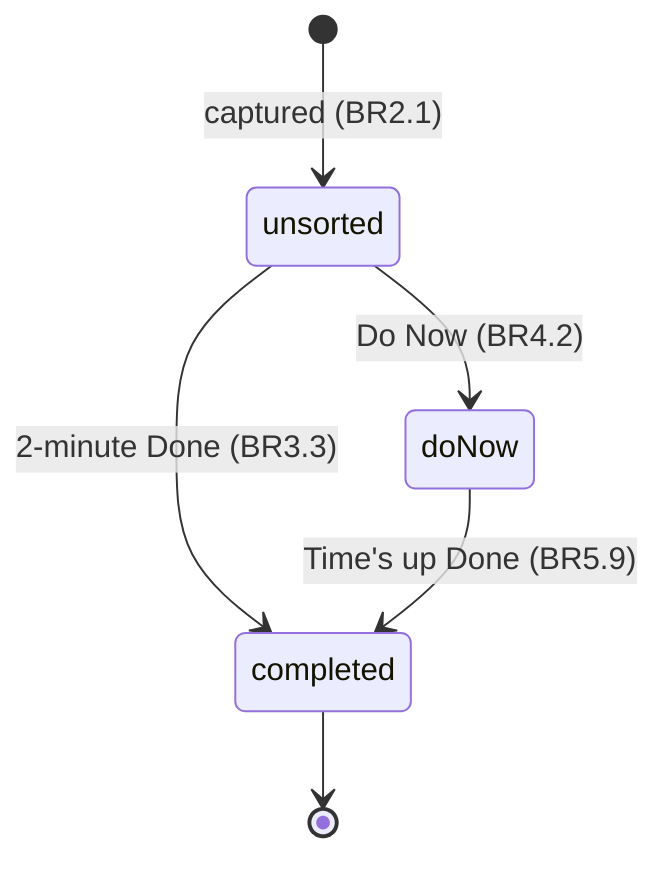
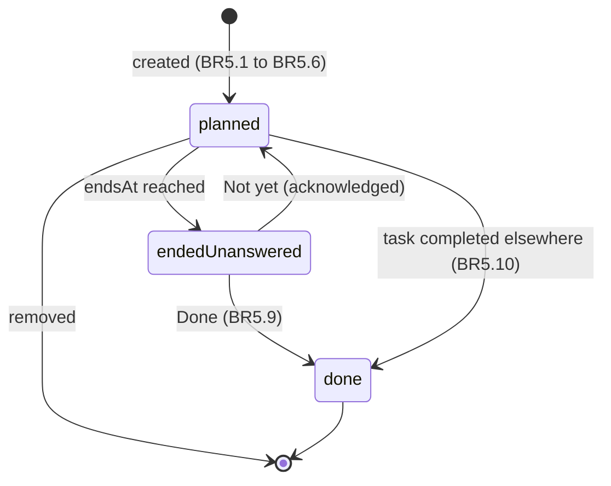
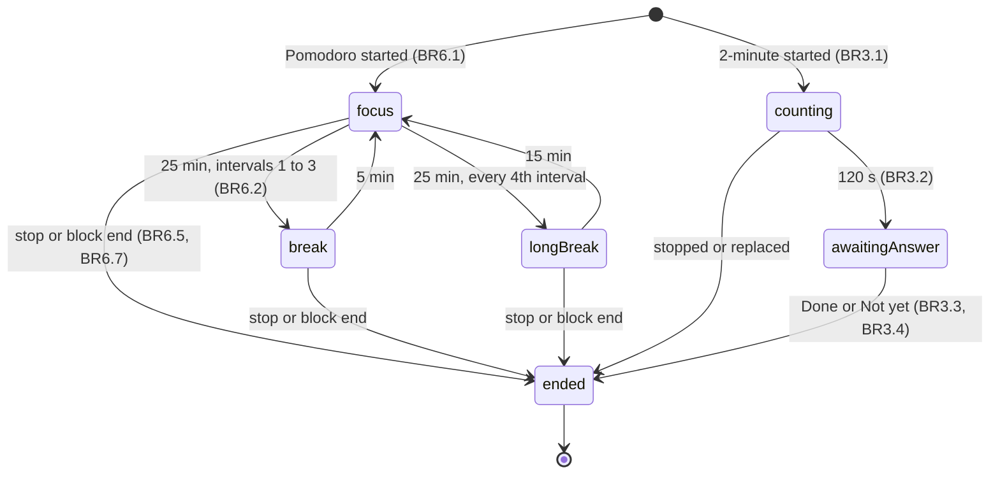
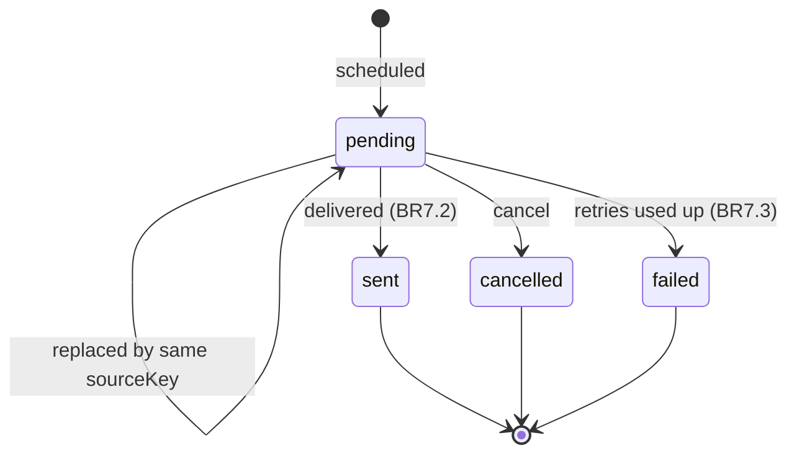
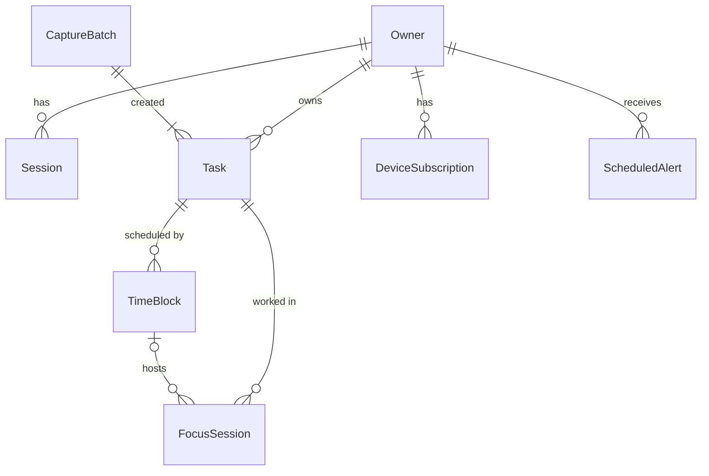

# Functional Specification: U1 Core loop slice

U1 is the walking skeleton: the smallest Timely that runs the whole core loop
for real. A signed-in owner captures a brain dump, does one item with the
2-minute rule, sorts one into Do Now, blocks it on today's timeline, works it
in a Pomodoro, and is notified when the interval or block ends.

This file is the source of truth for **workflows** (numbered steps) and
**state machines**. The data shapes are in `entities.md` and the decision logic
in `rules.md` (both source of truth for their part); the ER diagram and rules
summary below are derived views of them.

Stories: US1.1, US2.1, US2.2, US3.1, US4.1, US5.1, US6.1, US7.1.
Components touched: Account, Tasks, Planning, Focus, Notifications, WebApp,
plus the app shell (one server, database, outbox, configuration).

## Workflows

### WF1 Create the owner (one time, on the server)

1. The operator runs `create-owner --email <email> --time-zone <IANA name>` on the server.
2. The command checks that no Owner exists (BR1.4). If one exists it stops with "An owner already exists" and a non-zero exit.
3. It validates the email form and the time zone name.
4. It asks for the password twice without echoing it; it requires at least 12 characters and matching entries.
5. It stores the Owner with the password hash only and default message windows (10:00, 13:00, 16:00).
6. It prints "Owner created" and exits 0. Nothing about the password is printed or logged.

### WF2 Sign in and reach Today (US1.1)

1. The owner opens any Timely page. The web app asks the server for the current session.
2. Without a valid session the server answers 401 (BR1.1); the web app shows the sign-in screen and nothing else.
3. The owner enters email and password and submits.
4. The server checks the attempt limit (BR1.5); if blocked it answers 429 and the screen says to try again in a few minutes.
5. The server verifies the credentials. On failure it records the failure and answers 401 "Sign-in failed" (BR1.3); the screen shows that message and keeps the email typed.
6. On success it clears the failure count, creates a Session, sets the cookie and returns the CSRF token (BR1.2).
7. The web app keeps the CSRF token in memory for state-changing requests (BR1.6) and opens Today.
8. Sign-out deletes the session (`DELETE /session`) and returns to the sign-in screen.

### WF3 Brain dump (US2.1, US2.2)

1. The owner opens Capture and types or pastes lines.
2. On submit (button or Cmd+Enter) the web app creates a new Idempotency-Key for this submit and sends the lines.
3. The server validates size limits (BR2.2). On failure: 422 naming the lines; the text stays in the box.
4. The server checks the key (BR2.4). A known key with the same content returns the original tasks; with other content returns 422.
5. The server trims each line, skips blank ones, and creates one unsorted Task per remaining line with its position (BR2.1), together with the CaptureBatch, in one transaction (BR2.5).
6. It answers 201 with the created tasks.
7. The web app clears the box and shows "Added <n> items to your inbox" (singular for one).
8. If the response is an error or takes more than 10 seconds, the web app keeps the text, shows "Not saved. Your text is still here." and offers Retry, which resends with the **same** key (BR2.6).
9. A double tap sends the same key twice; the second request returns the first result (BR2.4).

### WF4 2-minute task (US3.1)

1. On the Sort screen the owner chooses "2-minute" on an unsorted task's card.
2. If another countdown is running, the server answers 409 and the web app asks "Stop the current countdown and start this one?" (BR6.6). Yes stops it (reason replaced) and repeats the start; No changes nothing.
3. The server starts a twoMinute session for the task (BR3.1), schedules the "2 minutes are up" alert (BR6.4), and returns the session.
4. The web app shows a 2:00 countdown computed from `startedAt` and `serverTime` (BR3.2, BR6.3).
5. At 0:00 the alert fires (BR7.2) and the web app asks "Done?" with **Done** and **Not yet**.
6. Done: the task is completed and leaves the unsorted list (BR3.3). Not yet: the task stays unsorted, unchanged (BR3.4).
7. If the app was closed at 0:00, the question is asked the next time the app opens (BR3.5).

### WF5 Sort into Do Now (US4.1)

1. The Sort screen shows the oldest unsorted task first (BR4.5).
2. The owner chooses **Do Now**. The web app sends the change with `If-Match: <version>`.
3. The server checks the version (BR4.4) and the allowed change (BR4.2, BR4.3), sets state doNow, increments version and writes TaskCategoryChanged to the outbox in the same transaction (BR8.2).
4. The task leaves the unsorted list and appears in Do Now; the next card is shown.
5. When no unsorted task is left, the screen shows "Inbox clear. Nothing to sort." with a button to Capture (BR4.6).
6. On 409 the web app reloads the task and says it changed on another device.

### WF6 Time-block a Do Now task today (US5.1)

1. Today shows the timeline for the owner's today and the Do Now tasks without a block. No other day is offered (BR5.2).
2. The owner places a task: on the Mac by dragging (snapping to 15 minutes), on the iPhone with the schedule sheet (start and end times on 5-minute marks).
3. The web app sends taskId, startsAt and endsAt with their offset.
4. The server validates, in order: task is doNow (BR5.1), times have offsets and are on 5-minute marks (BR5.7, BR5.6), end after start (BR5.3), at least 15 minutes (BR5.6), same local date as today (BR5.2), end no later than midnight (BR5.4), end after now (BR5.5). The first failure is returned with its field; nothing is saved.
5. On success the server creates the TimeBlock (status planned, version 1) and writes BlockCreated to the outbox in the same transaction.
6. Delivering BlockCreated schedules the block-end alert (BR5.8).
7. The block appears on the timeline at its time in the owner's time zone.
8. Removing a block (`DELETE /blocks/{id}`) writes BlockRemoved, which cancels its alert.

### WF7 Pomodoro in a block (US6.1)

1. The owner presses "Focus" on a planned block of today.
2. The server checks the block (BR6.1) and that no other countdown runs (BR6.6, as in WF4 step 2).
3. It creates a pomodoro session linked to the block and its task, phase focus, and schedules the phase-end alert at the end of the first 25 minutes, unless that is at or after the block's end (BR6.4, BR6.5).
4. The Focus view shows the task, the phase and the remaining time, computed from `startedAt` (BR6.3).
5. At each phase end the alert fires ("Break time" or "Back to focus") and the next phase's alert is scheduled. Phases follow 25/5 with a 15-minute break after every 4th focus interval (BR6.2).
6. "Stop" ends the session and cancels its alert; repeating it changes nothing (BR6.7).
7. When the block's end arrives during the session, the session ends with reason blockEnded, no separate phase alert fires, and the block-end flow (WF8) takes over (BR6.5).

### WF8 Block ends: Time's up (US7.1)

1. At the block's `endsAt` the block-end alert is sent to every registered device within 30 seconds, with sound (BR5.8, BR7.2).
2. If the web app is open, it plays a sound and opens the Time's up sheet for the block. Otherwise the notification opens `/today`, which shows the sheet.
3. The sheet asks whether the task is done: **Done** or **Not yet** (BR5.9).
4. Done: the block is marked done and the task completed in one transaction; TaskCompleted marks any other planned block of the task done and cancels their alerts (BR5.10).
5. Not yet: the block stays planned and the task stays in Do Now.
6. Either answer records `endAcknowledgedAt`, so the sheet is not shown again.
7. If the owner was away or notifications were off, every unanswered ended block of today is shown, oldest first, the next time the app opens (BR7.5).

### WF9 Notifications on a device (US7.1)

1. After sign-in, if this device has not decided on notifications, Today offers "Turn on notifications".
2. When the owner accepts, the browser asks for permission; on grant the web app subscribes with the server's public VAPID key and registers the subscription (BR7.1).
3. If permission is denied, unavailable (for example iPhone Safari not added to the home screen), or no subscription exists, Today shows "Notifications are off on this device" with the steps to turn them on (BR7.4).
4. The in-app scheduler sends due alerts (BR7.2) and handles push failures (BR7.3).

## State machines

### Task (U1 subset)

Text fallback: a captured task starts unsorted. From unsorted it goes to doNow
(sorted) or completed (2-minute Done). From doNow it goes to completed (Done at
the end of a block). Every other change is refused in U1 (BR4.3); delegated,
deferred and archived arrive in U2.

### TimeBlock

Text fallback: a block is created planned. When its end time passes and the
owner has not answered, it is "ended, unanswered" (a derived view: status
planned, endsAt in the past, no endAcknowledgedAt). Done moves it to done; Not
yet keeps status planned with endAcknowledgedAt set. A block is also marked done
when its task is completed some other way, and a planned block can be removed.

### FocusSession

Text fallback: a Pomodoro cycles focus 25 → break 5, with a 15-minute long break
after every 4th focus interval, until it is stopped or its block ends. A
2-minute countdown counts 120 seconds, then waits for Done or Not yet. Phases are
computed from elapsed time (BR6.3), not stored ticks. Only one session per owner
is not ended (BR6.6).

### ScheduledAlert

Text fallback: an alert is pending until it is sent, cancelled, or fails after
its retries. Scheduling again with the same source key replaces the pending one.

## Entity relationships (derived from `entities.md`)

Text fallback: an Owner has Sessions, Tasks, DeviceSubscriptions and
ScheduledAlerts. A CaptureBatch created one or more Tasks. A Task has zero or
more TimeBlocks and FocusSessions. A TimeBlock hosts zero or more Pomodoro
sessions; a 2-minute session has no block. SignInAttempt and OutboxEvent stand
alone.

## Rules summary (derived from `rules.md`)

| Area | Rules | Gist |
|---|---|---|
| Access | BR1.1–BR1.7 | session required, generic failure, one owner via command, rate limit, CSRF, owner scoping |
| Capture | BR2.1–BR2.6 | one task per non-blank line, size limits, plain text, idempotent, all-or-nothing, keep text on failure |
| 2-minute | BR3.1–BR3.5 | unsorted only, 120 s from start, Done completes, Not yet unchanged, ask again |
| Sort and lists | BR4.1–BR4.6 | one state, Do Now, U1-only changes, version checks, fixed order, empty state |
| Planning | BR5.1–BR5.10 | Do Now only, today only, end after start, before midnight, after now, 5-min marks and 15-min minimum, time zone, block-end alert, Done/Not yet, completion marks blocks done |
| Focus | BR6.1–BR6.7 | from a live block, 25/5/15 cycle, computed time, phase alerts, stop at block end, one at a time, idempotent stop |
| Notifications | BR7.1–BR7.5 | registration, 30-second delivery once, failure handling, "off" note, missed ends on next open |
| App shell | BR8.1–BR8.2 | environment configuration, outbox in the same transaction |

## End-to-end check for the skeleton

The Construction Verification Command for this unit must run, against the
running app in a real browser: create the owner (test database), sign in,
capture 5 lines, do one as a 2-minute task (Done), sort one into Do Now, block
it today, start a Pomodoro, and confirm that the interval-end alert is handed to
the push service (a fake push endpoint at the send boundary). The manual iPhone
notification check in `delivery-planning/bolt-plan.md` comes on top.

## Assumptions & Open Questions

- [assumption] The create-owner command takes the time zone as a required option; the owner changes it later in Settings (U5 screen; `PATCH /me/preferences` exists from U1).
- [assumption] The sign-in attempt limit is 5 failures per email and client address in 15 minutes, blocking for 15 minutes; NFR Requirements may tighten it.
- [assumption] A 2-minute countdown waiting for its answer does not count as "running" for BR6.6, so a new countdown can start; the old question is still asked.
- [assumption] Notification sound on a locked device is the operating system's default notification sound; the web app plays its own sound only while open.
- Open: session lifetime and idle timeout (C1 open question) are set in NFR Requirements.
- Open: VAPID key rotation is set in NFR Design (C5 open question).

## Sources

- `inception/units-generation/unit-of-work.md` (U1 boundaries and responsibilities) and `unit-of-work-story-map.md` (the eight slice stories).
- `inception/user-stories/stories.md` (acceptance criteria AC1.1.1 to AC7.1.3).
- `inception/requirements-analysis/requirements.md` (FR1 to FR9, FR13, NFR4, NFR5, NFR8).
- `inception/domain-design/components.md` and `decisions.md` (components, entities, ADR-001 to ADR-010).
- `inception/contract-design/contract-summary.md` (C1 HTTP API, C2 outbox events, C3 interfaces, C5 web push).
- `inception/refined-mockups/interaction-spec.md` (flow F1, 15-minute drag snapping, keyboard shortcuts).
- `[Q1]`–`[Q6]` `functional-design-questions.md` (owner creation, Time's up choices, Pomodoro at block end, past start times, time grid, one countdown at a time).
