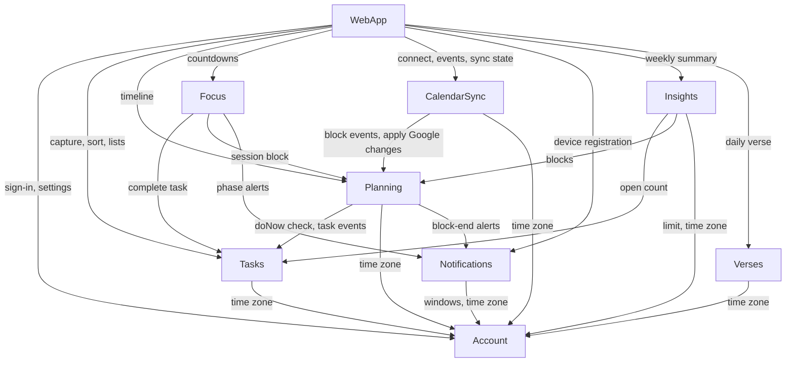

# Component Catalogue: Timely

Logical building blocks (code we write), from `requirements.md`, `stories.md`,
`refined-mockups/` and the answers in `domain-design-questions.md`. Deployment
topology, technology and NFR patterns are decided in later stages.
Architecture decisions are in `decisions.md` (ADR-001 to ADR-010).

```yaml
components:
  - name: Account
    summary: The owner's identity, sessions and preferences.
    behaviour: >
      Exactly one owner account in version 1 (FR1.2); every other component's
      records carry ownerId so more accounts can be added later. Every request
      except sign-in requires a valid session (FR1.1). Wrong credentials give
      one generic failure message. Preferences: time zone (IANA name, defines
      "today" everywhere, NFR5), message windows (default 10:00, 13:00, 16:00),
      open-list limit (whole number >= 1). Emits PreferencesChanged when a
      preference changes.
    responsibilities:
      - Sign-in, sign-out, session issue and expiry
      - Owner preferences (time zone, message windows, open-list limit)
      - Answering "what is today for this owner" from the time zone
    depends_on: []
    dependents:
      - component: Tasks
        interaction: owner's time zone for defer and follow-up dates
      - component: Planning
        interaction: owner's time zone for today's timeline and midnight carry-over
      - component: CalendarSync
        interaction: owner's time zone for reading today's Google events
      - component: Notifications
        interaction: message windows and time zone; reacts to PreferencesChanged
      - component: Insights
        interaction: open-list limit and time zone for week boundaries
      - component: Verses
        interaction: owner's time zone for "first visit today"
      - component: WebApp
        interaction: sign-in, session checks, settings screen
    external_dependencies:
      - name: Primary database
        kind: database
        purpose: owner, session and preference records
    entities:
      - name: Owner
        identifier: ownerId
        attributes: [ownerId, email, passwordHash, timeZone, messageWindows, openListLimit, updatedAt]
      - name: Session
        identifier: sessionId
        attributes: [sessionId, ownerId, createdAt, expiresAt]
        references: []

  - name: Tasks
    summary: Every task from capture to done, including the sort and follow-ups.
    behaviour: >
      Capture turns each non-blank line into an unsorted task; a capture batch is
      idempotent by key so a double submit creates nothing twice (FR2). A task has
      exactly one state: unsorted, doNow, delegated, deferred, archived (dropped)
      or completed. Delegate requires a name and a follow-up date of today or
      later; Defer requires a date after today in the owner's time zone; Drop
      archives and Restore returns to unsorted (FR4). A deferred task becomes
      unsorted again at local midnight of its date. Follow-ups due today are
      listed for Today; their actions are Done, Push date and Take back (US4.7).
      Every change checks the task's version; a stale version is rejected so
      one device never silently overwrites another (FR13.3). Unscheduled doNow
      tasks simply stay doNow (FR6.5). Emits TaskCategoryChanged and TaskCompleted.
    responsibilities:
      - Capture and capture idempotency
      - Sort categories, next step, delegate details, defer dates, archive/restore
      - Follow-up reminders and their actions
      - List queries with fixed ordering (FR13.2)
    depends_on:
      - component: Account
        interaction: owner's time zone to judge "today" and "future" dates
        style: sync
    dependents:
      - component: Planning
        interaction: confirms a task is doNow before blocking it; reacts to TaskCategoryChanged/TaskCompleted
      - component: Focus
        interaction: marks a task completed after a 2-minute countdown or block decision
      - component: Insights
        interaction: open-list count
      - component: WebApp
        interaction: capture, sort, lists, follow-ups
    external_dependencies:
      - name: Primary database
        kind: database
        purpose: task and capture-batch records
    entities:
      - name: Task
        identifier: taskId
        attributes: [taskId, ownerId, text, state, nextStep, delegateName, followUpDate, deferUntil, capturedAt, completedAt, archivedAt, version]
        references:
          - entity: Owner
            owned_by: Account
            relationship: each task belongs to one owner
      - name: CaptureBatch
        identifier: idempotencyKey
        attributes: [idempotencyKey, ownerId, createdAt, taskIds]
        references:
          - entity: Owner
            owned_by: Account
            relationship: each capture batch belongs to one owner

  - name: Planning
    summary: Today's time blocks.
    behaviour: >
      Only today (owner's time zone) can be planned (FR6.1). A block points to one
      doNow task, starts before it ends, and ends today (FR6.2). Overlaps are
      allowed and reported (FR6.4). A task may have several blocks today (needs
      more time). When a task leaves doNow, its blocks today are removed after
      the owner confirmed in the Web App (US4.5); when it is completed, its open
      blocks are marked done. Block end decisions: Done, Needs more time (extend
      or add), Reschedule (FR9.2). Blocks carry a version; stale updates are
      rejected. Asks Notifications to schedule a block-end alert for every block.
      Emits BlockCreated, BlockChanged, BlockRemoved for CalendarSync.
    responsibilities:
      - Create, move, resize, remove, mark done for time blocks
      - Overlap detection
      - Block-end decisions
      - Applying calendar-side changes handed over by CalendarSync
    depends_on:
      - component: Tasks
        interaction: check task is doNow; subscribe to TaskCategoryChanged and TaskCompleted
        style: sync
      - component: Account
        interaction: owner's time zone for "today"
        style: sync
      - component: Notifications
        interaction: schedule and cancel block-end alerts
        style: sync
    dependents:
      - component: CalendarSync
        interaction: subscribes to block events; applies Google-side moves and deletes
      - component: Focus
        interaction: links a Pomodoro session to a block
      - component: Insights
        interaction: planned and done block counts per day
      - component: WebApp
        interaction: today's timeline and scheduling
    external_dependencies:
      - name: Primary database
        kind: database
        purpose: time block records
    entities:
      - name: TimeBlock
        identifier: blockId
        attributes: [blockId, ownerId, taskId, localDate, startsAt, endsAt, status, updatedAt, version]
        references:
          - entity: Task
            owned_by: Tasks
            relationship: each block schedules one task; a task can have several blocks
          - entity: Owner
            owned_by: Account
            relationship: each block belongs to one owner

  - name: Focus
    summary: All countdowns - Pomodoro, the 2-minute countdown and the 5-minute start.
    behaviour: >
      Remaining time is computed from the recorded start instant and total paused
      time, never by counting ticks, so sleep, background and reload never drift
      it (FR8.3). Pomodoro: 25 min focus, 5 min break, 15 min long break after
      every 4th focus interval; fixed in version 1 (FR8.2). Pause, resume and stop
      are idempotent (US6.3). The 2-minute countdown ends (at 0:00 or on cancel) in
      a Done / Not yet choice; Done completes the task in Tasks (US3.1, US3.2). The
      5-minute start ends in Keep going (starts a Pomodoro) or Stop (US6.4). Every
      phase end is scheduled as an alert with Notifications and cancelled on
      pause or stop.
    responsibilities:
      - Focus sessions and their phases
      - 2-minute and 5-minute countdowns
      - Alerts for phase ends
    depends_on:
      - component: Tasks
        interaction: complete a task after a Done answer
        style: sync
      - component: Planning
        interaction: find the block a session belongs to
        style: sync
      - component: Notifications
        interaction: schedule and cancel phase-end alerts
        style: sync
    dependents:
      - component: WebApp
        interaction: focus view and countdowns
    external_dependencies:
      - name: Primary database
        kind: database
        purpose: focus session records
    entities:
      - name: FocusSession
        identifier: sessionId
        attributes: [sessionId, ownerId, taskId, blockId, mode, startedAt, pausedAt, pausedMs, completedIntervals, phase, endedAt]
        references:
          - entity: Task
            owned_by: Tasks
            relationship: each session is about one task
          - entity: TimeBlock
            owned_by: Planning
            relationship: a Pomodoro session may run inside one block

  - name: CalendarSync
    summary: Translation layer between Google Calendar and Timely's blocks.
    behaviour: >
      Anti-corruption layer: no other component sees Google's model (ADR-004).
      Holds one Google connection per owner with encrypted tokens (NFR4). Reads
      today's events from the chosen calendar as read-only (FR7.1). Writes every
      block as one event and updates or removes it on block changes, keyed by the
      block so retries never create duplicates (FR7.2, FR7.4). Picks up changes to
      Timely-created events within the sync interval (FR7.3). When both sides
      changed since the last sync, the more recent change wins and a
      ConflictResolved notice is recorded for the owner (US8.3). When Google is
      unreachable it keeps a per-block sync state ("not yet synced") and retries
      with capped backoff; revoked access marks the connection disconnected
      (FR7.5). Logs every sync failure without task text or tokens (NFR8).
    responsibilities:
      - Google connection lifecycle (connect, refresh, disconnect, revoked)
      - Reading today's events
      - Two-way sync of blocks and conflict resolution
      - Sync state and last-synced time for the UI
    depends_on:
      - component: Planning
        interaction: subscribe to block events; apply Google-side moves and deletes
        style: event
      - component: Account
        interaction: owner's time zone for "today's events"
        style: sync
    dependents:
      - component: WebApp
        interaction: connect flow, today's events, sync state, conflict notices
    external_dependencies:
      - name: Google Calendar API
        kind: third-party-api
        purpose: read events and write Timely's blocks
      - name: Google OAuth
        kind: third-party-api
        purpose: owner's consent and access tokens
      - name: Primary database
        kind: database
        purpose: connection, event-link and conflict-notice records
    entities:
      - name: GoogleConnection
        identifier: connectionId
        attributes: [connectionId, ownerId, calendarId, encryptedTokens, status, lastSyncedAt]
        references:
          - entity: Owner
            owned_by: Account
            relationship: each owner has at most one connection
      - name: EventLink
        identifier: blockId
        attributes: [blockId, googleEventId, syncState, lastSyncedBlockVersion, googleUpdatedAt, lastError]
        references:
          - entity: TimeBlock
            owned_by: Planning
            relationship: each link mirrors one block as one Google event
      - name: ConflictNotice
        identifier: noticeId
        attributes: [noticeId, ownerId, blockId, keptSide, replacedSummary, createdAt, seenAt]
        references:
          - entity: TimeBlock
            owned_by: Planning
            relationship: each notice is about one block

  - name: Notifications
    summary: Every alert the owner receives.
    behaviour: >
      Owns device subscriptions for system notifications and a schedule of
      alerts. Other components schedule or cancel alerts by a source key, so
      rescheduling replaces rather than duplicates. Delivers within 30 seconds of
      the due time when notifications are allowed (FR9.1). Builds the daily
      message-window reminders from the owner's preferences and rebuilds them on
      PreferencesChanged (FR10). Reports whether any device can receive
      notifications so the Web App can show the "notifications are off" note
      (FR9.3). Logs delivery failures without task text (NFR8).
    responsibilities:
      - Device subscriptions
      - Alert scheduling, cancellation and delivery
      - Message-window reminders
    depends_on:
      - component: Account
        interaction: message windows and time zone; subscribe to PreferencesChanged
        style: sync
    dependents:
      - component: Planning
        interaction: block-end alerts
      - component: Focus
        interaction: phase-end alerts
      - component: WebApp
        interaction: register a device; check notification status
    external_dependencies:
      - name: Web push service
        kind: third-party-api
        purpose: deliver system notifications to Mac and iPhone browsers
      - name: Primary database
        kind: database
        purpose: subscriptions and scheduled alerts
    entities:
      - name: DeviceSubscription
        identifier: subscriptionId
        attributes: [subscriptionId, ownerId, endpoint, publicKeys, createdAt, lastFailureAt]
        references:
          - entity: Owner
            owned_by: Account
            relationship: an owner has one subscription per device
      - name: ScheduledAlert
        identifier: alertId
        attributes: [alertId, ownerId, sourceKey, kind, fireAt, title, status]
        references:
          - entity: Owner
            owned_by: Account
            relationship: each alert is for one owner

  - name: Insights
    summary: The weekly summary, computed on request.
    behaviour: >
      Stores nothing (ADR-006). For the Monday-to-Sunday week in the owner's time
      zone it computes days with a plan, planned blocks, done blocks and the open
      list against the limit (FR12.1). With no planned blocks it reports "no
      blocks planned" instead of a percentage (FR12.3).
    responsibilities:
      - Weekly summary figures
    depends_on:
      - component: Tasks
        interaction: open-list count
        style: sync
      - component: Planning
        interaction: blocks planned and done per day
        style: sync
      - component: Account
        interaction: open-list limit and time zone
        style: sync
    dependents:
      - component: WebApp
        interaction: weekly summary screen
    external_dependencies: []
    entities: []

  - name: Verses
    summary: The daily verse shown at first planning each day.
    behaviour: >
      Holds a server-side list of short verses, seeded with Ephesians 5:15-16,
      Proverbs 6:6-8 and Matthew 6:34 (FR11.1); there is no editing screen in
      version 1, the list is changed directly in the data (Q8, follow-up 1).
      Returns today's verse only if it has not been dismissed today in the
      owner's time zone (FR11.2).
    responsibilities:
      - Verse list
      - Per-day shown and dismissed state
    depends_on:
      - component: Account
        interaction: owner's time zone for "today"
        style: sync
    dependents:
      - component: WebApp
        interaction: show and dismiss today's verse
    external_dependencies:
      - name: Primary database
        kind: database
        purpose: verses and daily views
    entities:
      - name: Verse
        identifier: verseId
        attributes: [verseId, reference, text, active]
      - name: VerseView
        identifier: viewId
        attributes: [viewId, ownerId, localDate, verseId, dismissedAt]
        references:
          - entity: Verse
            owned_by: Verses
            relationship: each view shows one verse
          - entity: Owner
            owned_by: Account
            relationship: each view belongs to one owner

  - name: WebApp
    summary: The screens from the mockups, on Mac and iPhone.
    behaviour: >
      Presents state and collects input; the server components make the final
      decision on every rule (ADR-009). Checks fields as the owner types for fast
      feedback. Keeps an unsaved draft in the browser so session expiry never
      loses typed text (US1.2). Shows offline and stale states when the server
      or Google is unreachable. Implements keyboard shortcuts and accessibility
      from `refined-mockups/`.
    responsibilities:
      - All screens, navigation and keyboard shortcuts
      - Local drafts of unsaved input
      - Device notification permission and registration
    depends_on:
      - component: Account
        interaction: sign-in, sessions, settings
        style: sync
      - component: Tasks
        interaction: capture, sort, lists, follow-ups
        style: sync
      - component: Planning
        interaction: today's timeline
        style: sync
      - component: Focus
        interaction: countdowns
        style: sync
      - component: CalendarSync
        interaction: Google connect, events, sync state, conflict notices
        style: sync
      - component: Notifications
        interaction: device registration and status
        style: sync
      - component: Insights
        interaction: weekly summary
        style: sync
      - component: Verses
        interaction: daily verse
        style: sync
    dependents: []
    external_dependencies:
      - name: Browser storage
        kind: other
        purpose: unsaved drafts on this device only
    entities:
      - name: Draft
        identifier: draftKey
        attributes: [draftKey, screen, content, savedAt]
```

## Component Diagram



Text fallback: WebApp calls every server component. Account depends on nothing.
Tasks, Notifications and Verses depend only on Account. Planning depends on
Tasks, Account and Notifications. Focus depends on Tasks, Planning and
Notifications. CalendarSync depends on Planning and Account. Insights depends on
Tasks, Planning and Account. There are no cycles.

## Component Summary

| Component | Purpose | Depends On | Dependents | Entities Owned |
|---|---|---|---|---|
| Account | Identity, sessions, preferences | — | Tasks, Planning, CalendarSync, Notifications, Insights, Verses, WebApp | Owner, Session |
| Tasks | Tasks from capture to done | Account | Planning, Focus, Insights, WebApp | Task, CaptureBatch |
| Planning | Today's time blocks | Tasks, Account, Notifications | CalendarSync, Focus, Insights, WebApp | TimeBlock |
| Focus | All countdowns | Tasks, Planning, Notifications | WebApp | FocusSession |
| CalendarSync | Google Calendar translation and sync | Planning, Account | WebApp | GoogleConnection, EventLink, ConflictNotice |
| Notifications | Every alert | Account | Planning, Focus, WebApp | DeviceSubscription, ScheduledAlert |
| Insights | Weekly summary | Tasks, Planning, Account | WebApp | — |
| Verses | Daily verse | Account | WebApp | Verse, VerseView |
| WebApp | Screens | all server components | — | Draft (browser only) |

## Entity Ownership

| Entity | Owning Component | Identifier | Attributes | References |
|---|---|---|---|---|
| Owner | Account | ownerId | email, passwordHash, timeZone, messageWindows, openListLimit, updatedAt | — |
| Session | Account | sessionId | ownerId, createdAt, expiresAt | — |
| Task | Tasks | taskId | ownerId, text, state, nextStep, delegateName, followUpDate, deferUntil, capturedAt, completedAt, archivedAt, version | Owner |
| CaptureBatch | Tasks | idempotencyKey | ownerId, createdAt, taskIds | Owner |
| TimeBlock | Planning | blockId | ownerId, taskId, localDate, startsAt, endsAt, status, updatedAt, version | Task, Owner |
| FocusSession | Focus | sessionId | ownerId, taskId, blockId, mode, startedAt, pausedAt, pausedMs, completedIntervals, phase, endedAt | Task, TimeBlock |
| GoogleConnection | CalendarSync | connectionId | ownerId, calendarId, encryptedTokens, status, lastSyncedAt | Owner |
| EventLink | CalendarSync | blockId | googleEventId, syncState, lastSyncedBlockVersion, googleUpdatedAt, lastError | TimeBlock |
| ConflictNotice | CalendarSync | noticeId | ownerId, blockId, keptSide, replacedSummary, createdAt, seenAt | TimeBlock |
| DeviceSubscription | Notifications | subscriptionId | ownerId, endpoint, publicKeys, createdAt, lastFailureAt | Owner |
| ScheduledAlert | Notifications | alertId | ownerId, sourceKey, kind, fireAt, title, status | Owner |
| Verse | Verses | verseId | reference, text, active | — |
| VerseView | Verses | viewId | ownerId, localDate, verseId, dismissedAt | Verse, Owner |
| Draft | WebApp | draftKey | screen, content, savedAt | — |

## External Dependencies

| Component | Dependency | Kind | Purpose |
|---|---|---|---|
| Account, Tasks, Planning, Focus, CalendarSync, Notifications, Verses | Primary database | database | each component's own records (no component reads another's records directly) |
| CalendarSync | Google Calendar API | third-party-api | read events, write blocks |
| CalendarSync | Google OAuth | third-party-api | consent and tokens |
| Notifications | Web push service | third-party-api | system notifications |
| WebApp | Browser storage | other | unsaved drafts |

## Rationale

| Component | Why it is a separate building block |
|---|---|
| Account | Distinct concern (identity and security) and the root every record hangs from; changes rarely. |
| Tasks | Owns the task lifecycle end to end; every sort rule changes here and nowhere else (ADR-001). |
| Planning | Time is a separate concern from what the task is; a task can have zero or several blocks (ADR-003). |
| Focus | Timer correctness (sleep, reload, pause) is its own hard problem, shared by three countdown types (ADR-002). |
| CalendarSync | Isolates Google's model, tokens and failure modes behind one boundary (ADR-004). |
| Notifications | One place for delivery, subscriptions and retries, used by three components (ADR-005). |
| Insights | Read-only reporting that changes for different reasons than the data it reads (ADR-006). |
| Verses | Small content concern with its own data and daily state, kept out of Account (ADR-008). |
| WebApp | Presentation only; the server decides every rule (ADR-009). |

**Alternatives rejected** (details in `decisions.md`): separate inbox, delegation
and deferral components (ADR-001); 2-minute countdown inside Tasks (ADR-002);
times stored on the task (ADR-003); Planning calling Google directly (ADR-004);
per-component notifications (ADR-005); stored running totals (ADR-006); a
separate Settings component (ADR-007); verses built into the Web App (ADR-008);
offline-first client (ADR-009).
