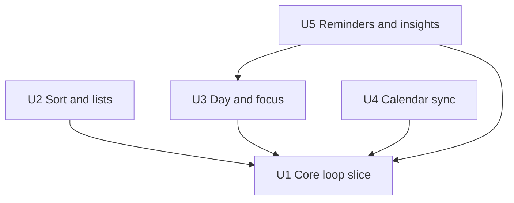

# Unit Dependencies: Timely

Topology only. Build order and priorities are chosen in Delivery Planning.

## Dependency DAG

- U2 Sort and lists depends on U1 Core loop slice (extends Tasks, Sort screen and lists built in U1).
- U3 Day and focus depends on U1 (extends Planning, Focus and the Today and Focus screens).
- U4 Calendar sync depends on U1 (needs time blocks and the Today timeline).
- U5 Reminders and insights depends on U1 (Notifications, Account preferences) and U3 (counts end-of-block decisions).



Text fallback: U1 has no dependencies. U2, U3 and U4 each depend only on U1.
U5 depends on U1 and U3. There are no cycles.

```yaml
units:
  - name: u1-core-loop-slice
    kind: service
    depends_on: []
  - name: u2-sort-and-lists
    kind: service
    depends_on: [u1-core-loop-slice]
  - name: u3-day-and-focus
    kind: service
    depends_on: [u1-core-loop-slice]
  - name: u4-calendar-sync
    kind: service
    depends_on: [u1-core-loop-slice]
  - name: u5-reminders-and-insights
    kind: service
    depends_on: [u1-core-loop-slice, u3-day-and-focus]
```

## Walking skeleton

U1 is the only unit with no dependencies, so it is first in every valid order.
It runs on its own: the app shell, sign-in, capture, Do Now sort, a block today,
a Pomodoro and the end notification are all inside U1, so the whole core loop
can be demonstrated before any later unit exists.

## Integration points

All units live in one app, so integration is in-process through module
interfaces and in-process events (ADR-010):

| Between | Mechanism | What crosses |
|---|---|---|
| U2 → U1 (Tasks) | module interface | category changes, follow-up actions on Task |
| U2 → U1 (Planning) | event `TaskCategoryChanged` | Planning removes a task's blocks when it leaves Do Now |
| U3 → U1 (Planning, Focus) | module interface | block updates, session pause/resume, end decisions |
| U3 → U1 (Tasks) | module interface | complete or reschedule a task at block end; version checks |
| U4 → U1 (Planning) | events `BlockCreated/Changed/Removed`; module interface | mirror blocks to Google; apply Google-side moves and deletes |
| U5 → U1 (Account, Notifications) | event `PreferencesChanged`; module interface | rebuild message-window reminders |
| U5 → U3 (Planning) | module interface | done blocks per day for the summary |

Shared data: none across modules. Each module owns its tables in the one
database (components.md External Dependencies).

## Parallel development opportunities

After U1, the units U2, U3 and U4 have no dependency on each other and can be
built in any order or side by side. U5 can start once U3 is in place.
